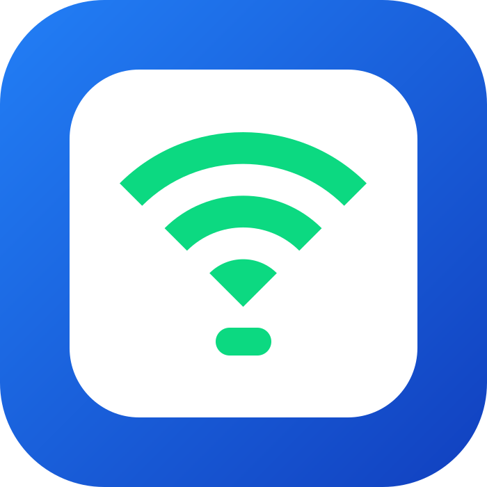

<p align="center">
  
</p>

<h1 align="center">Smart Wall Socket</h1>

<p align="center">
  <b>IoT Smart Energy & Switching Ecosystem — Powered by ESP32, ESP8266 & Android</b>
</p>

<p align="center">
  <a href="https://github.com/Danushka-Madushan/smart-wall-socket/releases"></a>
  <a href="https://github.com/Danushka-Madushan/smart-wall-socket/actions"></a>
  
  
</p>

---

## 📖 Overview

**Smart Wall Socket** is an open-source IoT home automation and energy monitoring ecosystem. The platform transforms standard electrical outlets into intelligent, authenticated power nodes that stream real-time electrical telemetry (voltage, current, active power, power factor) and allow secure wireless control.

The ecosystem is driven by a shared companion **Android app (SocketMan)** communicating over **mDNS** and **HTTP REST** with mutual **Proof of Possession (PoP)** authentication.

The project provides two production firmware nodes tailored for different hardware profiles:

| Hardware Node | Primary Purpose | Key Features | Firmware Guide |
|---|---|---|---|
| **ESP-32S Node** | High-Precision Smart Wall Socket | True-RMS voltage & current sampling on FreeRTOS Core 1, single-relay inverted hardware logic, **Espressif Unified BLE Provisioning**, 128x64 OLED dashboard, NVS storage. | [ESP-32S README](firmware/esp-32S/README.md) |
| **ESP-8266 Node** | 2-Channel Wireless Smart Switch | Controls two independent relay channels via C945 NPN transistors, Wi-Fi client auto-reconnect, 128x32 OLED, EEPROM with checksum integrity. | [ESP-8266 README](firmware/esp-8266/README.md) |

---

## 🏗️ System Architecture

```
                          +------------------------------------------+
                          |        Android App (SocketMan)           |
                          |  - mDNS ZeroConf Discovery               |
                          |  - Camera QR Code Scanner (PoP)          |
                          |  - Real-Time Energy Dashboard            |
                          +--------------------+---------------------+
                                               |
                     +-------------------------+-------------------------+
                     | Wi-Fi (LAN / mDNS)                                | BLE / Wi-Fi
                     v                                                   v
+------------------------------------------+    +------------------------------------------+
|          ESP8266 Smart Switch            |    |          ESP-32S Smart Socket            |
|                                          |    |                                          |
|  - 2 Relay Channels (GPIO 12, GPIO 14)   |    |  - 1 Relay Channel (GPIO 4 Inverted)     |
|  - 128x32 OLED Display                   |    |  - ADS1115 16-Bit ADC (Core 1 FreeRTOS)  |
|  - Wi-Fi Station Mode                    |    |  - SCT-013 (Current) + ZMPT101B (Voltage)|
|  - EEPROM Storage (Checksummed)          |    |  - Espressif BLE Provisioning (WiFiProv) |
|  - PoP Pairing (NODE_SEC_4102)           |    |  - 128x64 OLED Display (Dual-Mode)       |
+------------------------------------------+    +------------------------------------------+
```

---

## 📂 Project Structure

```
smart-wall-socket/
├── client/                           # Android application (SocketMan)
│   ├── app/
│   │   └── src/main/java/nibm/iot/socketman/
│   │       ├── MainActivity.kt
│   │       ├── network/              # REST & BLE Clients (SmartSwitchApiClient, BleProvisioningManager)
│   │       ├── ui/screens/           # Jetpack Compose UI (Home, Hub, BLE Prov, PoP Claim, Energy & Control)
│   │       └── viewmodel/            # MdnsSwitchViewModel & State Architecture
│   ├── build.gradle.kts
│   └── settings.gradle.kts
├── firmware/
│   ├── esp-32S/                      # Enhanced ESP32-S Smart Wall Socket Firmware
│   │   ├── include/                  # Config.h
│   │   ├── lib/                      # PowerMonitor, RelayController, DisplayManager, etc.
│   │   ├── src/                      # Config.cpp, main.cpp
│   │   ├── platformio.ini            # huge_app partition & library dependencies
│   │   └── README.md                 # Full ESP-32S Technical Specification
│   └── esp-8266/                     # 2-Channel ESP8266 Smart Switch Firmware
│       ├── include/                  # Config.h
│       ├── lib/                      # RelayController, DisplayManager, ApiServer, etc.
│       ├── src/                      # Config.cpp, main.cpp
│       ├── platformio.ini            # PlatformIO NodeMCU config
│       └── README.md                 # Full ESP-8266 Technical Specification
├── pop-gen/                          # Web PoP QR Code & Sticker Generator (GitHub Pages)
│   ├── index.html                    # Client-side web app
│   ├── css/                          # Modern dark glassmorphism & print styles
│   ├── js/                           # Zero-dependency QR engine & badge compositor
│   └── README.md                     # Deployment & thermal printing guide
├── docs/                             # Documentation, diagrams, and project PDFs
└── .github/workflows/               # GitHub Actions CI/CD (automated APK builds)
```

---

## 🔐 Security Architecture: Proof of Possession (PoP)

Both hardware nodes enforce a **Proof of Possession (PoP)** security handshake. Unclaimed sockets accept energy polling and discovery, but strictly reject relay control requests (`401 Unauthorized`) until paired by physically scanning the device's unique QR code.

> [!TIP]
> **PoP QR & Sticker Generator Web App**: Generate, customize, and print high-resolution physical pairing stickers using the included web tool in [`pop-gen/`](pop-gen/) or directly through [GitHub Pages](https://danushka-madushan.github.io/smart-wall-socket/pop-gen/).


### Compact Semicolon QR Standard

To optimize optical recognition on small physical stickers, the ecosystem uses a high-efficiency **semicolon-separated values (SSV)** format:

```text
<version>;<device_id>;<pop_secret>;<transport>
```

| Node | QR String to Print | Character Count | QR Symbol Matrix |
|---|---|---|---|
| **ESP-32S** | `v1;PROV_A1B2C3;S3_SEC_9821;ble` | **29 chars** | Version 2 (25×25) |
| **ESP-8266** | `v1;RELAY_8266_NODE;NODE_SEC_4102;lan` | **34 chars** | Version 2 (25×25) |

> **Optical Advantage:** Reducing payload size from verbose JSON (~75 chars) down to ~30 chars cuts module density by **58%**, making individual dots physically larger on stickers for instantaneous camera recognition.

---

## 🌐 Unified REST API Specification

Both nodes expose identical endpoints over HTTP Port 80, maintaining compatibility with the Android client:

| Method | Endpoint | Description | ESP8266 | ESP-32S |
|---|---|---|:---:|:---:|
| `GET` | `/api/info` | Device metadata, switches count, transport, and claim status | ✅ | ✅ |
| `GET` | `/api/heartbeat` | Health check, uptime, RSSI, and free heap | ✅ | ✅ |
| `GET` | `/api/wifi/status` | Wi-Fi connection parameters (SSID, IP, MAC, RSSI) | ✅ | ✅ |
| `GET` | `/api/energy` | High-frequency telemetry (voltage_V, current_A, power_W, PF) | ❌ | ✅ |
| `POST` | `/api/claim` | Binds device to app by verifying PoP PIN and caching `master_token` | ✅ | ✅ |
| `GET/POST`| `/api/verify` | Validates `master_token` authorization | ✅ | ✅ |
| `GET` | `/api/relay` | Gets current relay states (requires token if claimed) | ✅ | ✅ |
| `POST` | `/api/relay` | Sets relay states (`{"state": bool}`) | ✅ | ✅ |
| `POST` | `/api/relay/1` | Sets/toggles Switch 1 | ✅ | ✅ |
| `POST` | `/api/relay/2` | Sets/toggles Switch 2 | ✅ | ❌ |
| `POST` | `/api/relay/all`| Sets all relay channels | ✅ | ✅ |
| `POST` | `/api/unclaim` | Factory reset: clears master token and unclaims device | ✅ | ✅ |

---

## 📱 Android App (SocketMan)

The companion Android application is built with modern Android best practices:
- **UI Framework**: Jetpack Compose + Material 3.
- **Architecture**: MVVM with Kotlin Coroutines and StateFlow.
- **Discovery**: ZeroConf mDNS discovery via Android Network Service Discovery (`NsdManager`).
- **QR Scanning**: Google ML Kit Barcode Scanning with automatic multi-format payload parsing (semicolon and legacy JSON) and target ID mismatch alerts.
- **Energy Tracking**: Real-time wattage graph, accumulated kWh usage, and tiered CEB electricity bill calculation.

### Building the Mobile App

```bash
cd client
./gradlew assembleRelease
```
The compiled APK will be generated at `client/app/build/outputs/apk/release/app-release.apk`.

---

## 🚀 Building & Flashing Firmware

Ensure [PlatformIO Core (CLI)](https://platformio.org/install/cli) is installed.

### Flashing the ESP-32S Node
```bash
cd firmware/esp-32S
pio run --target upload
pio device monitor --baud 115200
```

### Flashing the ESP-8266 Node
```bash
cd firmware/esp-8266
pio run --target upload
pio device monitor --baud 115200
```

---

## 📄 Documentation Links

- [ESP-32S Technical Manual](firmware/esp-32S/README.md)
- [ESP-8266 Technical Manual](firmware/esp-8266/README.md)
- [ESP-32S BLE Provisioning Guide](firmware/esp-32S/how-to.md)
- [Hardware Circuit Schematic](docs/IoT%20-%20Curcuit%20Design.pdf)
- [Project Presentation](docs/IoT%20SMART%20Wall%20Socket.pdf)

---

## 📝 License

This project is open-source and released under the [MIT License](LICENSE).
